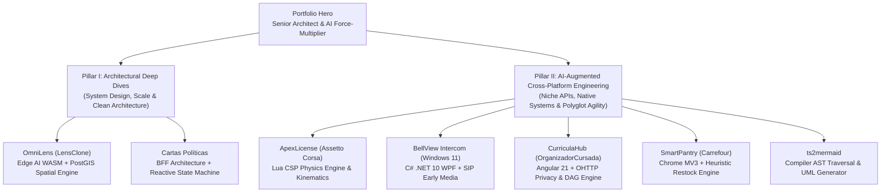
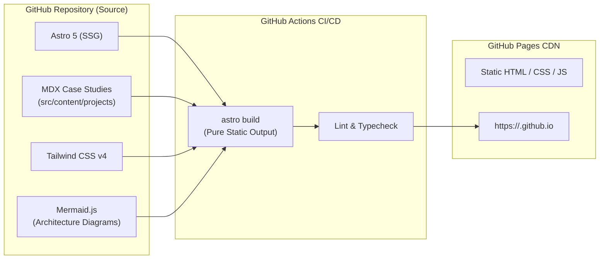

# Portfolio System Design Document
**Target Deployment:** GitHub Static Pages (`gh-pages`)  
**Architecture:** Astro 5 + Tailwind CSS v4 + TypeScript + MDX + Mermaid.js  
**Professional Positioning:** Senior Fullstack & Systems Architect — AI Force-Multiplier  

---

## 1. Executive Summary & Professional Positioning

### 1.1 The Narrative Core
The portfolio positions the author not just as a developer who uses code, but as a **Senior Fullstack / Systems Architect** who treats **AI agents as a strategic force multiplier**. 

Modern engineering leadership requires two complementary superpowers:
1. **Systems & Software Architecture:** The ability to architect robust, resilient, clean systems (BFF pattern, spatial indexing, edge computer vision, reactive state machines, dependency injection).
2. **Cross-Platform Polyglot Agility via AI Synergy:** The capacity to step outside one's traditional comfort zone and ship production-grade software across heterogeneous runtimes, niche gaming APIs, native desktop frameworks, and compiler toolchains by directing AI agents with architectural precision.

### 1.2 Two Flagship Narrative Pillars
The portfolio organizes all showcased projects into two explicit pillars:



---

## 2. Refined Project Catalog & Market Branding

Each project repository is elevated to a commercial-grade product name and refined marketing pitch, mapping repository assets to clear technical accomplishments:

| Repository Name | Market Product Name | Domain / Stack | Showcase Focus | Core Architecture / Engineering Highlights |
| :--- | :--- | :--- | :--- | :--- |
| **`LensClone-Backend` & `LensClone-Frontend`** | **OmniLens** *(Price Intelligence & Vision Engine)* | Angular 22, ONNX WASM, Web Workers, .NET 10 Web API, PostgreSQL / PostGIS | **System Architecture** | Zero-GC Float32Array buffer pooling, DBNet & CRNN OCR models on background Web Workers, PostGIS spatial radius indexing (SRID 4326). |
| **`CartasPoliticas-Backend` & `CartasPoliticas-Frontend`** | **Cartas Políticas** *(Real-Time Multiplayer Battler)* | Node.js, Express, TypeScript, TSyringe DI, MongoDB, Socket.io, Angular 18, NgRx | **System Architecture** | Decoupled BFF pattern, TSyringe IoC container, bidirectional WebSocket state sync, NgRx reactive state machine with deterministic turn loops. |
| **`AssettoCorsa-GTLikeLicenses`** | **ApexLicense** *(Gran Turismo Driving Academy)* | Lua (CSP SDK), Python, HTML5 Canvas, Assetto Corsa Engine | **AI-Augmented Multi-Platform** | Real-time physics hooks, AI spline offset tracking, kinematic straight-line detection, headless simulation test runner. |
| **`VOIPBell-Windows`** | **BellView Intercom** *(Windows 11 Native Intercom)* | C# .NET 10, WPF, Windows 11 Fluent / Mica, DPAPI, SIP, WMF | **AI-Augmented Multi-Platform** | Windows notification tray lifecycle, low-latency H.264 early media video, DPAPI encrypted credentials, JSON-RPC & DTMF door strikes. |
| **`OrganizadorCursada`** | **CurriculaHub** *(Privacy-Preserving Academic Planner)* | Angular 21 Signals, Material 21, Oblivious HTTP (OHTTP), Vitest | **AI-Augmented Multi-Platform** | Reactive DAG prerequisite engine, $k$-anonymity pre-flight sanitizer, anti-Sybil rating via zero-knowledge OHTTP relays. |
| **`carrefour-reposicion-extension`** | **SmartPantry** *(Automated Restock Assistant)* | Chrome Extensions (Manifest V3), Service Workers, Local Storage | **AI-Augmented Multi-Platform** | Zero-server privacy model, reverse-engineered OMS session reuse, adaptive inter-purchase periodicity heuristics. |
| **`tsTypes2umlBack`** | **ts2mermaid** *(TypeScript AST to UML Diagram Engine)* | TypeScript, Compiler API, Mermaid AST, Express, Commander CLI | **AI-Augmented Multi-Platform** | AST node traversal, recursive type resolution, modular class/sequence diagram generator, CLI & REST service. |

---

## 3. Information Architecture & User Journey

### 3.1 Sitemap
```
/
├── index.html                    (Flagship Home: Hero, Architectural Deep Dives, AI Showcase, Philosophy)
├── projects/
│   ├── omnilens/                 (Full Case Study: Edge Vision & PostGIS Spatial Architecture)
│   ├── cartas-politicas/         (Full Case Study: BFF Pattern, IoC & Real-Time Card Battler)
│   ├── apex-license/             (Full Case Study: CSP Lua Engine, Physics Hooks & Modding)
│   ├── bellview-intercom/        (Full Case Study: Windows 11 Fluent .NET 10 & SIP Door Control)
│   ├── curriculahub/             (Full Case Study: Angular 21 DAG Scheduling & OHTTP Privacy)
│   ├── smart-pantry/             (Full Case Study: Chrome MV3 Local Restock Heuristics)
│   └── ts2mermaid/               (Full Case Study: TypeScript AST Traversal & Mermaid Generation)
├── architecture/                 (High-level architectural philosophy & system design blueprints)
└── 404.html                      (Custom GitHub Pages fallback)
```

### 3.2 Page Section Anatomy (Home Page)
1. **Sticky Glassmorphic Navigation:**
   - Brand logo / monogram.
   - Jump links: `Architectural Deep Dives`, `AI & Cross-Platform`, `Philosophy & Stack`, `Contact`.
   - GitHub icon & Resume download button.
2. **Hero Header:**
   - Headline: *Systems Architect & Polyglot Engineer*.
   - Value Proposition: *Architecting high-scale distributed backends and browser-edge AI — while directing AI agents to master niche runtimes, native OS APIs, and game simulation engines.*
   - Dynamic Stat Badges: `7 Polyglot Stacks`, `Zero-GC WASM Vision`, `PostGIS Spatial Indexing`, `C# .NET 10 Native`.
3. **Pillar I: Architectural Deep Dives (`#architecture`):**
   - Featured interactive cards for **OmniLens** and **Cartas Políticas**.
   - Side-by-side architecture preview diagrams rendered via Mermaid.js.
   - "Architecture Decisions" callout pill tags (e.g. `BFF Pattern`, `TSyringe DI`, `NetTopologySuite`, `WASM Web Workers`).
   - Primary CTA: *Read Architectural Case Study →*.
4. **Pillar II: AI-Augmented Cross-Platform Showcase (`#cross-platform`):**
   - Visual grid of the 5 multi-platform projects.
   - Each card displays:
     - Platform target badge (e.g., `Assetto Corsa CSP Lua`, `Windows 11 WPF Desktop`, `Chrome Extension MV3`, `Angular 21 + OHTTP`, `Node.js AST Tooling`).
     - Framed embed mockup preview.
     - "AI Multiplier Factor" highlight (explaining what complex hurdle AI agentic workflows solved).
     - Link to full case study and GitHub repository.
5. **Engineering Philosophy & AI Synergy (`#philosophy`):**
   - Breakdown of the agentic workflow: Formal Schema Contracts → Headless Math Simulation → Static Typing & ASTs → Parallelized Execution.
6. **Unified Polyglot Stack Matrix (`#skills`):**
   - Categorized badges:
     - *Languages:* TypeScript, C# .NET, Lua, Python, JavaScript, SQL.
     - *Frontend & Edge:* Angular (18-22), ONNX Runtime Web, WebAssembly, WebRTC, Tailwind CSS, NgRx, Signals.
     - *Backend & Systems:* ASP.NET Core, Express, TSyringe, PostGIS, MongoDB, Socket.io, Docker.
     - *Desktop & Native:* WPF (.NET 10), Windows DPAPI, WMF, SIP / VoIP protocols.
7. **Footer:**
   - Centralized social links, copyright, and source code link to the portfolio repository.

---

## 4. Visual Design System: Standardized Neutral Container with Framed Embeds

Per the selected design direction, the global container maintains an ultra-clean, modern dark-slate aesthetic, allowing each project's individual visual identity to shine through framed mockups and high-fidelity previews.

### 4.1 Global Design Tokens
- **Backgrounds:**
  - Base: `#0B0F17` (Deep Obsidian Void)
  - Surface Card: `#111827` (Slate Card Surface)
  - Elevated Card: `#1F2937` (Bordered interactive element)
- **Borders & Dividers:**
  - Standard: `rgba(255, 255, 255, 0.08)`
  - Active/Hover: `rgba(99, 102, 241, 0.4)` (Subtle Indigo Glow)
- **Typography:**
  - Primary Sans: `Inter` / `system-ui` (clean readability for technical prose)
  - Monospace: `JetBrains Mono` / `Fira Code` (for AST code snippets, schemas, terminal commands)
- **Accents:**
  - Primary Electric Indigo: `#6366F1`
  - Success Cyan: `#06B6D4`
  - Warning Amber: `#F59E0B`

### 4.2 Standardized Framed Device Containers
To celebrate each project's unique aesthetic without disrupting visual consistency:
1. **Desktop / Window Frame (`<DesktopFrame />`):**
   - Title bar with 3 macOS/Windows window dots, subtle title text, and clean dark border. Used for **BellView Intercom** and **Cartas Políticas** web views.
2. **Browser Viewport Frame (`<BrowserFrame />`):**
   - Minimalist URL bar with lock icon and tab preview. Used for **CurriculaHub** and **OmniLens**.
3. **Extension Popup Frame (`<ExtensionFrame />`):**
   - Exact Chrome browser extension popup dimensions with toolbar drop shadow. Used for **SmartPantry**.
4. **Simulator / Telemetry Canvas Frame (`<SimFrame />`):**
   - Carbon-fiber / dark-grid telemetry viewport with GT-style sector indicators. Used for **ApexLicense**.
5. **Terminal / CLI Console Frame (`<TerminalFrame />`):**
   - Monospace shell prompt with colored syntax blocks. Used for **ts2mermaid**.

---

## 5. Technical Architecture & Tech Stack



### 5.1 Tech Stack Breakdown
- **Static Site Engine:** [Astro 5](https://astro.build/) in `output: 'static'` mode.
  - Generates zero unnecessary JavaScript by default.
  - Native Content Collections with full TypeScript schema validation (`astro:content`).
- **Styling:** [Tailwind CSS v4](https://tailwindcss.com/) with typography plugin (`@tailwindcss/typography`) for editorial case study readability.
- **Diagrams & System Blueprints:** [Mermaid.js](https://mermaid.js.org/) via client-side island or pre-rendered SVG for instant architecture visualization.
- **Icons:** [Lucide Icons](https://lucide.dev/) (`lucide-astro` / lightweight SVG).
- **Deployment:** GitHub Actions workflow deploying statically to GitHub Pages.

### 5.2 Content Collections Schema (`src/content.config.ts`)
```typescript
import { defineCollection, z } from 'astro:content';

const projects = defineCollection({
  schema: z.object({
    title: z.string(),
    repoName: z.string(),
    tagline: z.string(),
    pillar: z.enum(['architecture', 'ai-multiplatform']),
    category: z.string(),
    featured: z.boolean().default(false),
    order: z.number(),
    techStack: z.array(z.string()),
    metrics: z.array(z.object({
      label: z.string(),
      value: z.string(),
    })).optional(),
    architectureFocus: z.array(z.string()).optional(),
    aiMultiplierStory: z.string().optional(),
    githubUrl: z.string().url().optional(),
    demoUrl: z.string().url().optional(),
    coverImage: z.string(),
  }),
});

export const collections = { projects };
```

### 5.3 Centralized Site Configuration (`src/config/site.config.ts`)
```typescript
export interface SiteConfig {
  authorName: string;
  roleTitle: string;
  headline: string;
  bio: string;
  githubUrl: string;
  linkedinUrl: string;
  email: string;
  repoBaseUrl: string;
}

export const siteConfig: SiteConfig = {
  authorName: "Your Name",
  roleTitle: "Senior Fullstack & Systems Architect",
  headline: "Architecting Resilient Distributed Systems — Accelerated by Autonomous AI Agents",
  bio: "Senior engineer focused on clean distributed architectures, browser-edge computer vision, and reactive state machines. Leveraging AI agents to rapidly execute across low-level native systems, niche game runtimes, and compiler toolchains.",
  githubUrl: "https://github.com/your-username",
  linkedinUrl: "https://linkedin.com/in/your-profile",
  email: "your-email@example.com",
  repoBaseUrl: "https://github.com/your-username",
};
```

---

## 6. Detailed Project Case Study Blueprints

### 6.1 OmniLens (LensClone) — Case Study Blueprint
- **Pillar:** Architectural Deep Dive (Edge AI + Geospatial Scale)
- **Framing:** Bringing computer vision and real-time retail intelligence directly into the browser viewport while offloading spatial aggregation to PostGIS.
- **Architecture Diagram:**
  - Browser Client: Camera Feed → WebRTC → Web Worker (DBNet ONNX WASM Text Detection + CRNN OCR) → Zero-GC `Float32Array` Buffer Pool → Reactive Signals Store → 2D Canvas Overlay.
  - Backend API: ASP.NET Core Web API → Entity Framework Core → NetTopologySuite → PostgreSQL + PostGIS spatial index `ST_DWithin` (SRID 4326 GPS coords).
- **Architectural Highlights:**
  - Preventing GC pauses during 30 FPS video analysis using reusable tensor buffer pooling.
  - PostGIS geospatial indexing for high-speed spatial proximity price comparison within dynamic kilometer radiuses.

### 6.2 Cartas Políticas — Case Study Blueprint
- **Pillar:** Architectural Deep Dive (Decoupled BFF & Deterministic State Machine)
- **Framing:** Building a real-time multiplayer card battler with strict server-authoritative state synchronization.
- **Architecture Diagram:**
  - Angular 18 Frontend → NgRx Store / Effects → Socket.io Client.
  - Node.js Express BFF (`CP.BFF.Web`) → TSyringe Inversion of Control (IoC) Container → Match Engine → MongoDB (Mongoose schemas) + Socket.io Server Gateway.
- **Architectural Highlights:**
  - Backend-for-Frontend (BFF) decoupling the client presentation logic from core domain card engine services.
  - TSyringe dependency injection ensuring loose coupling and in-memory mock testing via `mongodb-memory-server`.
  - Deterministic turn loop timer and anti-cheat card adjudication over WebSockets.

### 6.3 ApexLicense (Assetto Corsa Modding) — Case Study Blueprint
- **Pillar:** AI-Augmented Cross-Platform Engineering
- **Framing:** Entering the specialized, niche world of automotive simulation modding to build a complete 5-tier Gran Turismo driving curriculum in Assetto Corsa.
- **The AI Multiplier Story:** Directing AI agents to ingest undocumented Custom Shaders Patch (CSP) Lua C++ bindings, derive kinematic straight-line detection math for rolling starts, and construct a headless validation test suite for `.ai` track splines.
- **Engineering Highlights:**
  - Dynamic 3D car teleportation and native AI autopilot rolling launches.
  - Vector canvas HUD and real-time failure adjudicator (wall strikes, off-track thresholds, spin velocity).

### 6.4 BellView Intercom (VOIPBell Windows) — Case Study Blueprint
- **Pillar:** AI-Augmented Cross-Platform Engineering
- **Framing:** Developing a native Windows 11 Fluent desktop app for SIP door stations and access control hardware.
- **The AI Multiplier Story:** Leveraging AI to rapidly implement complex native Windows APIs (.NET 10, WPF Mica/Acrylic materials, Windows DPAPI for credential encryption, Windows Media Foundation for local MP4 recording, and low-latency H.264 early media RTP parsing).
- **Engineering Highlights:**
  - Unattended system tray background monitoring with instant early-media popup.
  - Dual door strike trigger via JSON-RPC 2.0 WebServices and in-call DTMF audio tones.

### 6.5 CurriculaHub (OrganizadorCursada) — Case Study Blueprint
- **Pillar:** AI-Augmented Cross-Platform Engineering
- **Framing:** A modern, privacy-first university degree and schedule management system with community study plan sharing.
- **The AI Multiplier Story:** Directing AI agents to model complex Directed Acyclic Graph (DAG) prerequisite rules using Angular 21 reactive signals, and implementing cutting-edge privacy standards (Oblivious HTTP relays and $k$-anonymity sanitizers).
- **Engineering Highlights:**
  - Dynamic conflict-free timetable matrix with iCal export.
  - Decoupled community plan workshop preventing cohort fingerprinting.

### 6.6 SmartPantry (Carrefour Extension) — Case Study Blueprint
- **Pillar:** AI-Augmented Cross-Platform Engineering
- **Framing:** A lightweight, privacy-preserving Chrome Extension (Manifest V3) that predicts household grocery restock schedules.
- **The AI Multiplier Story:** Using AI to inspect network payloads from Carrefour's Order Management System (OMS), reverse-engineer private session reuse, and formulate inter-purchase interval algorithms with zero external server dependencies.
- **Engineering Highlights:**
  - 100% local client execution via `chrome.storage.local`.
  - Heuristic categorization: *Atrasado, reponer* (>130% interval), *Te toca pronto* (80-130%), and *Al día*.

### 6.7 ts2mermaid — Case Study Blueprint
- **Pillar:** AI-Augmented Cross-Platform Engineering
- **Framing:** Developer productivity CLI and microservice converting complex TypeScript types and classes into clean Mermaid UML diagrams.
- **The AI Multiplier Story:** Guiding AI through TypeScript compiler API internals (`ts.createSourceFile`, AST node visitors, symbol resolution) to reliably extract inheritance, composition, and method signatures into Mermaid syntax.
- **Engineering Highlights:**
  - Dual interface: Fast developer CLI tool and Express REST API service.
  - Modular class diagram generation and sequence flow diagram synthesis.

---

## 7. Implementation Roadmap & Milestones

1. **Phase 1: Project Scaffolding & Design System Foundations**
   - Initialize Astro 5 project in `D:\Repositories\Portfolio` with Tailwind CSS v4 and TypeScript.
   - Configure centralized `site.config.ts` and `astro:content` collections schemas.
   - Implement base layouts (`Layout.astro`, `CaseStudyLayout.astro`) and navigation/footer.
   - Build framed container components (`DesktopFrame`, `BrowserFrame`, `ExtensionFrame`, `SimFrame`, `TerminalFrame`).

2. **Phase 2: Home Page & Dual-Track Showcase**
   - Build Hero section with positioning metrics and narrative copy.
   - Build **Pillar I: Architectural Deep Dives** featured cards with Mermaid diagrams.
   - Build **Pillar II: AI-Augmented Cross-Platform** interactive project showcase.
   - Build Philosophy, Skills Matrix, and Contact sections.

3. **Phase 3: Content Authoring & Case Studies (MDX)**
   - Author rich case studies for all 7 projects in `src/content/projects/*.mdx`.
   - Embed Mermaid architecture charts, code highlights, and framed mockup screenshots.

4. **Phase 4: GitHub Actions & Static Deployment Pipeline**
   - Create `.github/workflows/deploy.yml` configured for GitHub Pages static site deployment.
   - Configure base path handling for custom domain or `<username>.github.io/<repo>`.
   - Perform automated build and responsive audit.
