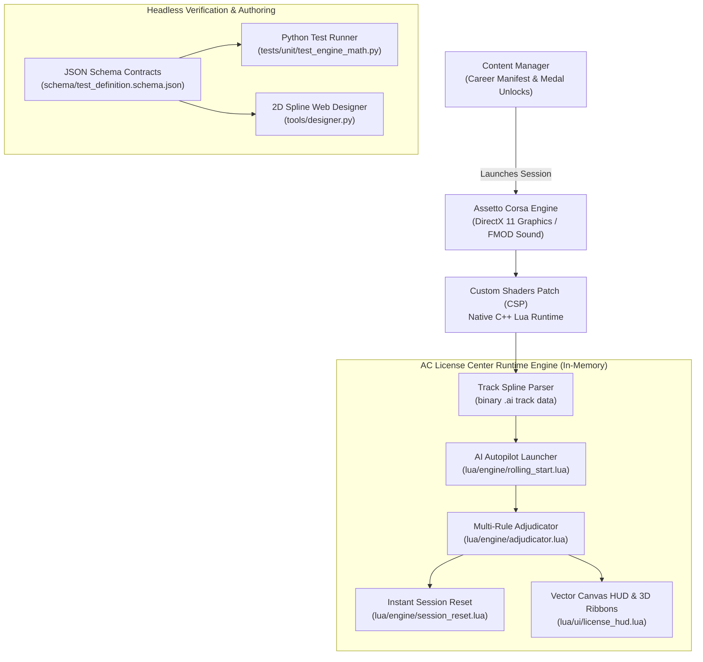

import SimFrame from '../../components/frames/SimFrame.astro';

<SimFrame title="Assetto Corsa — CSP Lua Telemetry Runtime" class="my-8">
  

    

      

        
        IB-1: High-Speed Downforce Braking (Monza Turn 1)
      

      
Target Time (Gold): 0:18.250

    

    

      

        
VEHICLE VELOCITY

        
264.8 km/h

        
Spline AI Offset: +0.12m

      

      

        
ADJUDICATOR STATE

        
PASSED SECTOR 1

        
Wall Impact Threshold: 0g

      

      

        
ROLLING LAUNCH ENGINE

        
AUTOPILOT ENGAGED

        
Control Transfer at 100m

      

    

  

</SimFrame>

## Project Overview

In the classic *Gran Turismo* series, License Tests served as a masterclass in motorsport fundamentals. They taught players not just how to drive fast, but *why* race cars behave the way they do — methodically progressing from basic straight-line threshold braking and weight transfer up to high-downforce prototypes and full-circuit mastery.

**AC License Center** replicates and expands this iconic experience natively inside **Assetto Corsa**, combining Custom Shaders Patch (CSP) Lua hooks, event-driven state machines, and a complete 5-tier driver development curriculum built with 100% official Kunos cars and tracks:

- **Isolated Sector Challenges**: Over 50 progressive tests ranging from 100m–1000m braking boxes and hairpins to high-speed chicanes and complex esses.
- **Strict Adjudication Engine**: Instant disqualification on wall impacts (&gt; 1500 N threshold), exceeding allowed wheels off-track, or vehicle spin-outs (&gt; 90° yaw deviation).
- **Sub-Second In-Memory Session Resets**: Instantaneous trial retries (&lt; 800ms) bypassing Assetto Corsa's lengthy DirectX asset reloads.
- **Native AI Autopilot Rolling Starts**: Smooth speed and heading synchronization along binary track splines before seamless control handover to the driver.
- **Content Manager Career Integration**: Packaged into a drag-and-drop distribution archive (`release/AssettoCorsa_GT_Licenses.zip`) with unlock progressions from **National B** to **Super License**.

---

## Technical Architecture & Simulation Runtime

---

## Core Engineering Implementations

### 1. In-Memory Session Resets Bypassing 3D Engine Reloads
A primary challenge in racing simulator modding is restart latency. Standard Assetto Corsa session restarts force a complete teardown and reload of DirectX meshes, shaders, and FMOD sound banks, imposing an 8 to 15-second loading screen between failed runs.

AC License Center eliminates this overhead entirely by managing trial resets in memory (`lua/engine/session_reset.lua`):
- **Instantaneous Teleportation**: Bypasses engine restart cycles by freezing simulation time, zeroing momentum, repositioning the car transform, and re-engaging launch state in under 800 milliseconds.
- **State Machine Isolation**: Notifies listeners across the HUD, 3D gate visualizer, and PCM audio engine to reset cleanly without leaking state.
- **Accidental Abort Protection**: Distinguishes active driving inputs from terminal state confirmations—only a dedicated restart hotkey (`R`) can reset during live trials, while standard gamepad buttons (`A`/`Start`) and spacebar are accepted once a pass/fail modal is reached.

---

### 2. Real-Time Adjudication & Kinematic Failure Detection
Enforcing authentic Gran Turismo driving test standards requires continuous sub-frame evaluation of vehicle dynamics. The `Adjudicator` engine (`lua/engine/adjudicator.lua`) monitors multi-axis vehicle metrics on every simulation step:

- **Track Boundary Offsets**: Counts wheel contact patches outside drivable asphalt using raycasts, debouncing single-frame kerb excursions while penalizing &gt; 2 wheels completely off-surface.
- **Impact Force Sensor**: Traverses collision manifolds to detect barrier strikes exceeding 1500 N, distinguishing cosmetic paint scrapes from momentum-altering wall contact.
- **Vehicle Spin Adjudication**: Evaluates the angular divergence between vehicle velocity vector `v` and forward heading vector `h`. Exceeding 90° yaw divergence triggers an instant spin-out disqualification.
- **Stop Box Containment**: In braking trials, tracks vehicle coordinates within a designated deceleration zone and confirms complete zero-velocity standstill before the target time expires.

---

### 3. Native AI Autopilot Rolling Launch Engine
Certain license challenges (such as high-downforce braking at Monza Turn 1 or Laguna Seca's Corkscrew) require rolling starts at precise velocities (e.g., 260 km/h). Simply setting vehicle velocity artificially causes tire slip, suspension oscillation, and aerodynamic stall upon unpausing.

AC License Center solves this via **native CSP AI autopilot synchronization** (`lua/engine/rolling_start.lua`):
- **Spline Alignment**: Spawns the vehicle prior to the start gate and engages CSP native autopilot locked onto the circuit's `fast_lane.ai` spline.
- **Input Neutralization**: Locks user pedal and steering inputs during acceleration to prevent chassis destabilization before the timing line.
- **Dynamic Gearing**: Inspects the vehicle transmission spec to automatically select the optimal gear for the target approach speed.
- **Millisecond Handover**: Seamlessly disengages autopilot and releases user control locks the exact millisecond the vehicle crosses the start timing beam.

---

### 4. Headless Verification Suite & Interactive Spline Designer
Authoring 50+ license challenges across dozens of tracks without automated tooling would require hundreds of hours of manual in-game testing. The repository includes two custom developer productivity engines:

- **Headless Math Test Runner (`tests/unit/test_engine_math.py`)**: Runs pure Python physics and spline math simulations, verifying that gate coordinates, stop-box boundaries, target medal times, and vehicle acceleration envelopes are mathematically solvable without launching the 3D client.
- **Interactive 2D Spline Designer Web UI (`tools/designer.py`)**: A browser-based HTML5 Canvas tool that visualizes track `.ai` spline files, allows placing start/finish gates with real-time normal vector calculations, and exports directly to schema-compliant JSON test files.

---

## Architectural & Performance Benchmark Matrix

| Dimension | Vanilla Assetto Corsa | Naive CSP Mod Scripting | **AC License Center Engine Architecture** |
| :--- | :--- | :--- | :--- |
| **Retry Latency** | 8 – 15 seconds (Full asset reload) | 3 – 5 seconds (Partial reset) | **&lt; 800ms (Pure in-memory teleport)** |
| **Rolling Launch Stability** | N/A (Only standing pit starts) | High oscillation (Velocity injection) | **Native AI Autopilot Spline Lock** |
| **Off-Track Adjudication** | Binary AC penalty timer | Immediate disconnect / crash | **Debounced raycasts + 4-wheel tracking** |
| **Curriculum Structure** | Flat challenge list | Manual INI editing | **5-Tier Career with Progressive Unlocks** |
| **Test Verification** | Manual in-game driving | In-game testing | **Headless Python Math & Spline CI/CD** |
| **Installation Workflow** | Manual file extraction into AC root | Complex multi-folder copy | **1-Click Content Manager Drag & Drop** |

---

## Engineering Takeaways

1. **In-Memory Resets Transform User Experience**: In skill-building simulations where users fail repeatedly while refining their technique, eliminating 10-second reload screens fundamentally changes the engagement loop.
2. **Native AI Autopilot Outperforms Synthetic Velocity**: Bypassing vehicle physics via raw Cartesian velocity vectors causes tire scrub and suspension destabilization. Cooperating with the simulator's built-in AI navigation guarantees natural chassis dynamics at entry.
3. **Headless Math Simulators Save Enormous Time**: Decoupling simulation coordinates, track geometries, and target timings into JSON schema contracts and running headless Python validation suites enabled authoring 50+ complex trials with zero in-game trial-and-error.
