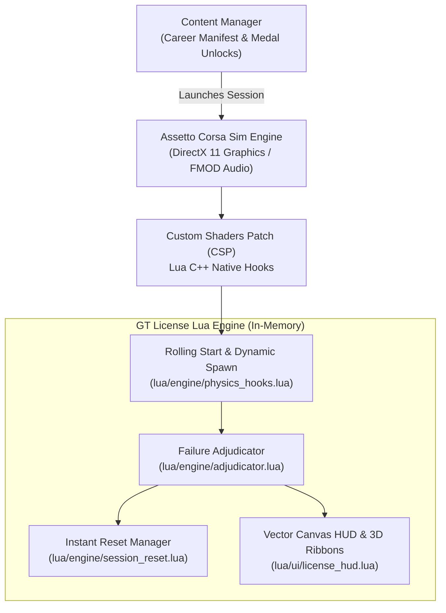

import SimFrame from '../../components/frames/SimFrame.astro';

<SimFrame title="Assetto Corsa — CSP Lua Telemetry Runtime" class="my-8">
  

    

      

        
        IB-1: High-Speed Downforce Braking (Monza Turn 1)
      

      
Target Time (Gold): 0:18.250

    

    

      

        
VEHICLE VELOCITY

        
264.8 km/h

        
Spline AI Offset: +0.12m

      

      

        
ADJUDICATOR STATE

        
PASSED SECTOR 1

        
Wall Impact Threshold: 0g

      

      

        
ROLLING LAUNCH ENGINE

        
AUTOPILOT ENGAGED

        
Control Transfer at 100m

      

    

  

</SimFrame>

## Project Overview

In the classic *Gran Turismo* series, License Tests served as a masterclass in motorsport fundamentals. They taught players not just how to go fast, but *why* cars behave the way they do — progressing from basic straight-line braking up to high-downforce racing and full-circuit mastery.

**ApexLicense** recreates this iconic experience inside **Assetto Corsa**, leveraging modern sim racing modding tools to deliver:
- Isolated sector challenges (e.g., 100m–1000m braking boxes, hairpins, high-speed chicanes).
- Strict Gran Turismo-style disqualification rules (instant fail on wall contact, track boundary violation, or vehicle spin).
- Sub-second instant retries without reloading track assets or restarting the 3D engine.
- Authentic GT HUD elements, 3D timing ribbons, guide lines, and sound effects.
- A structured 5-tier career progression from **National B** to **Super License**.

---

## Technical Architecture & Lua Runtime

---

## How AI Enabled Rapid Multi-Platform Mastery

Automotive simulator modding in Assetto Corsa has virtually no official API documentation; development requires piecing together C++ SDK exports, raw binary `.ai` spline files, and custom CSP INI extensions.

By pairing architectural system designs with autonomous AI agents:
1. **Kinematic Straight-Line Detection:** Developed an analyzer (`tools/straight_line_analyzer.py`) that parses track splines and computes 2nd-derivative curvature changes to automatically score optimal candidate straightaways for rolling starts.
2. **Headless Verification Pipeline:** Created an automated Python verification suite (`tools/run_full_validation_suite.py`) validating Lua syntax, schema constraints (`test_definition.schema.json`), and physical simulation coordinates without launching the heavy 3D game client.
3. **Web-Based Spline Designer:** Built an interactive 2D track spline editor (`tools/designer.py`) with HTML5 Canvas, enabling visual calibration of start/finish gates and instant export to Content Manager career packages.
