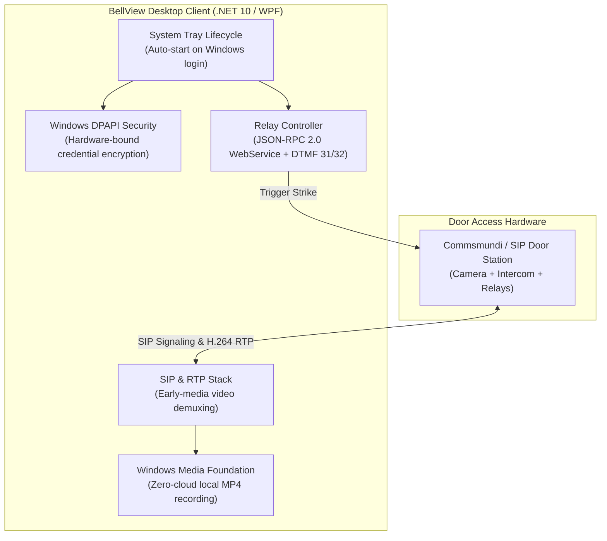

import DesktopFrame from '../../components/frames/DesktopFrame.astro';

<DesktopFrame title="BellView Intercom — Front Door Station (Incoming Ring)" class="my-8">
  

    

      

        
        Visitor Alert: Front Entrance Station
      

      
SIP: 101@192.168.1.120

    

    {/* Video Feed Simulation */}
    

      
[Early-Media H.264 Stream 720p @ 30FPS]

      
Visitor detected at main gate

      
Recording locally to MP4 via Windows Media Foundation

    

    {/* Door Strike Actions */}
    

      

        <button class="px-4 py-2 bg-emerald-600 hover:bg-emerald-500 rounded text-xs font-bold text-white transition-colors">
          Answer & Talk
        </button>
        <button class="px-4 py-2 bg-slate-800 hover:bg-slate-700 rounded text-xs font-medium text-slate-300 transition-colors">
          Dismiss
        </button>
      

      

        <button class="px-3 py-2 bg-indigo-600 hover:bg-indigo-500 rounded text-xs font-bold text-white transition-colors">
          Trigger Door 1 (JSON-RPC)
        </button>
        <button class="px-3 py-2 bg-indigo-900/60 hover:bg-indigo-800 border border-indigo-500/30 rounded text-xs font-medium text-indigo-300 transition-colors">
          Door 2 (DTMF 32)
        </button>
      

    

  

</DesktopFrame>

## Project Overview

**BellView Intercom** is a native Windows 11 desktop client designed for IP door intercoms and video access control systems. Rather than forcing building occupants to rely exclusively on mobile push notifications and smartphones, BellView Intercom runs in the Windows system tray, starts on boot, delivers real-time H.264 early-media video notifications, and triggers electronic door strikes with a single click.

---

## Technical Architecture & Security Model

---

## Engineering Highlights & The AI Advantage

1. **Native Windows 11 Fluent UI & Backdrop Materials:**  
   Implemented using WPF (.NET 10) with custom Windows DwmApi interop to invoke native Windows 11 Mica and Acrylic transparency surfaces without sacrificing framerates.
2. **Encrypted Local Storage via DPAPI:**  
   Eliminated cloud credential leakage by storing SIP passwords and WebService credentials encrypted on disk using `System.Security.Cryptography.ProtectedData` (Windows Data Protection API).
3. **Hardware Door Relay Control:**  
   Supports dual unlock mechanisms: asynchronous JSON-RPC 2.0 over HTTP with Basic Authentication, and in-band DTMF audio tones (`31` / `32`) during active conversations.
