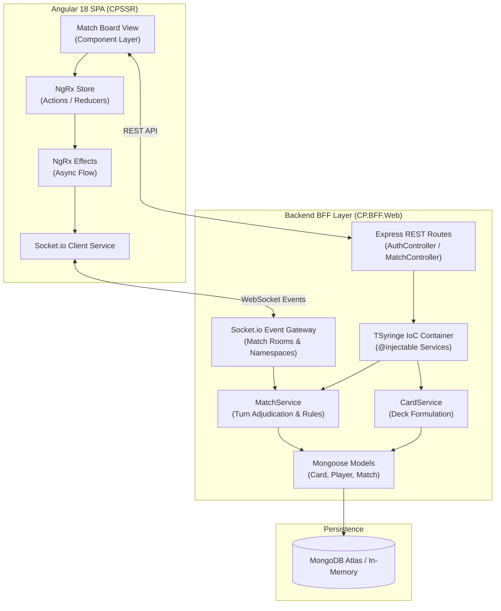

import DesktopFrame from '../../components/frames/DesktopFrame.astro';

<DesktopFrame title="Cartas Políticas — Active Multiplayer Match (Lobby #4912)" class="my-8">
  <div class="space-y-4">
    {/* Game Duel Canvas Preview */}
    <div class="flex items-center justify-between border-b border-white/10 pb-3">
      <div class="flex items-center gap-2">
        <span class="w-3 h-3 rounded-full bg-indigo-500 animate-pulse"></span>
        <span class="text-xs font-mono uppercase text-indigo-400">Match Status: IN_PROGRESS (Turn 4 / Round 2)</span>
      </div>
      <div class="text-xs font-mono text-amber-400">Turn Timer: 14s remaining</div>
    </div>

    <div class="grid grid-cols-1 sm:grid-cols-2 gap-4">
      {/* Player 1 Card Slot */}
      <div class="p-4 rounded-lg bg-slate-900 border border-indigo-500/30 flex flex-col justify-between">
        <div class="flex items-center justify-between text-xs text-slate-400 font-mono mb-2">
          <span>PLAYER 1 (LOCAL)</span>
          <span class="text-emerald-400 font-bold">POWER: 82</span>
        </div>
        <div class="bg-indigo-950/40 border border-indigo-500/20 rounded p-3 text-center my-2">
          <div class="text-xs text-indigo-300 font-bold uppercase">Figura Política #14</div>
          <div class="text-sm font-extrabold text-white">MINISTERIO DE ECONOMÍA</div>
          <div class="text-[11px] text-slate-400 mt-1">Habilidad: Aumenta influencia en +15 pts</div>
        </div>
        <div class="text-[11px] text-slate-500 font-mono">NgRx State: CARD_COMMITTED</div>
      </div>

      {/* Player 2 Card Slot */}
      <div class="p-4 rounded-lg bg-slate-900 border border-red-500/30 flex flex-col justify-between">
        <div class="flex items-center justify-between text-xs text-slate-400 font-mono mb-2">
          <span>OPPONENT (SOCKET.IO)</span>
          <span class="text-red-400 font-bold">POWER: 76</span>
        </div>
        <div class="bg-red-950/40 border border-red-500/20 rounded p-3 text-center my-2">
          <div class="text-xs text-red-300 font-bold uppercase">Figura Política #08</div>
          <div class="text-sm font-extrabold text-white">DEBATE PARLAMENTARIO</div>
          <div class="text-[11px] text-slate-400 mt-1">Habilidad: Bloquea cartas de gasto público</div>
        </div>
        <div class="text-[11px] text-slate-500 font-mono">Server Sync: ACK_RECEIVED</div>
      </div>
    </div>
  </div>
</DesktopFrame>

## Executive Architectural Summary

**Cartas Políticas** is a real-time multiplayer digital card strategy game based on contemporary Argentine political history. The platform requires strict synchronization guarantees: card placements, turn transitions, score calculations, and player disconnects must be handled deterministically without giving either client an opportunity to forge game state.

The application is structured around a **Backend-for-Frontend (BFF)** architecture (`CP.BFF.Web`), where an Express and TypeScript microservice coordinates with a **TSyringe Dependency Injection container** to enforce authoritative game rules, while an **Angular 18 Single Page Application** consumes events through a reactive **NgRx** state machine.

---

## High-Level System Architecture



---

## Core Architectural Engineering Highlights

### 1. Inversion of Control with TSyringe
In Node.js backends, tightly coupling router endpoints to domain services often leads to brittle test harnesses and circular dependency issues. Cartas Políticas relies on **TSyringe** for declarative Dependency Injection (DI):

```typescript
import { injectable, inject } from "tsyringe";
import { IMatchRepository } from "../repositories/IMatchRepository";
import { ISocketGateway } from "../gateways/ISocketGateway";

@injectable()
export class MatchService {
  constructor(
    @inject("MatchRepository") private matchRepo: IMatchRepository,
    @inject("SocketGateway") private socketGateway: ISocketGateway
  ) {}

  public async playCard(matchId: string, playerId: string, cardId: string) {
    const match = await this.matchRepo.findById(matchId);
    
    // Server-authoritative turn validation
    if (!match.isPlayerTurn(playerId)) {
      throw new Error("Illegal action: Not player's active turn.");
    }

    const adjudicationResult = match.resolveCardPlay(playerId, cardId);
    await this.matchRepo.save(match);

    // Broadcast authoritative state delta to both room peers
    this.socketGateway.broadcastToMatch(matchId, "MATCH_STATE_UPDATED", adjudicationResult);
  }
}
```

This IoC structure allows running comprehensive automated integration test suites with `mongodb-memory-server` and mocked WebSocket gateways, guaranteeing 100% deterministic test execution in Jest without external database dependencies.

### 2. NgRx Reactive State Synchronization
On the frontend, race conditions between incoming socket events and local user gestures are eliminated by channeling all network mutations through **NgRx Effects and Reducers**:

- User clicks card $\rightarrow$ Dispatches `[Match] PlayCardIntent`.
- Optimistic UI lock prevents double clicks while awaiting network transmission.
- Server returns authoritative WebSocket event $\rightarrow$ Dispatches `[Socket] MatchStateReceived`.
- Reducer updates state immutably; component re-renders seamlessly with Angular OnPush change detection.
