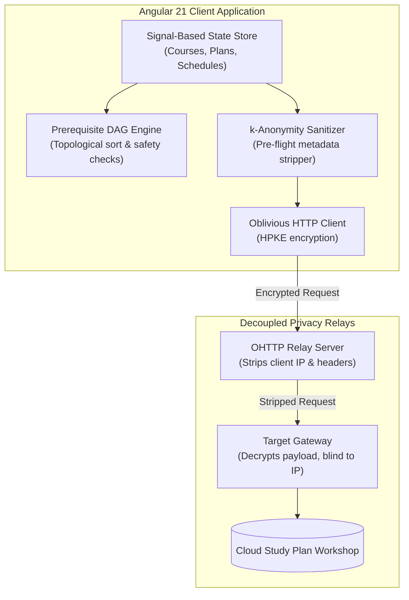

import BrowserFrame from '../../components/frames/BrowserFrame.astro';

<BrowserFrame url="https://curriculahub.internal.dev/schedule" class="my-8">
  

    

      

        
        Career Plan: Ingeniería en Sistemas (Semester 4)
      

      
DAG Status: Validated (No Missing Prerequisites)

    

    {/* Prerequisite Graph Node Grid */}
    

      

        
Aprobada (Req Passed)

        
Algoritmos & Estructuras de Datos

        
Final Exam: Passed (Score 9/10)

      

      

        
Cursando (In Progress)

        
Sistemas Operativos

        
Comisión 02 — Mar & Jue 18:30

      

      

        
Pendiente (Requires SO)

        
Redes de Información

        
Locked until SO is finished

      

    

  

</BrowserFrame>

## Project Overview

**CurriculaHub** is a modern, privacy-first web application built with **Angular 21** designed to help university students plan, manage, and visualize their academic degree trajectory. It features interactive course dependency trees, automated schedule collision detection, and a community study plan workshop.

---

## Technical Architecture & Privacy Engineering

---

## Engineering Highlights

1. **Reactive Prerequisite DAG Engine:**  
   Models study plan prerequisites as a Directed Acyclic Graph using Angular Signals (`signal`, `computed`, `effect`). When a student toggles a course status (e.g., from *Cursando* to *Aprobada*), dependent downstream subjects immediately update their unlock availability with zero recalculation lag.
2. **Oblivious HTTP (OHTTP) & $k$-Anonymity:**  
   Community workshop sharing decouples base curricula from elective selections to prevent cohort intersection fingerprinting. Plan submissions undergo automated client-side sanitization and are transmitted through OHTTP relays, making it cryptographically impossible for server operators to correlate degree progress with personal IP addresses.
3. **Automated Timetable Conflict Resolution:**  
   Calculates class commission overlaps in real time and offers one-click `.ics` export for synchronizing student timetables with Google Calendar and Apple Calendar.
