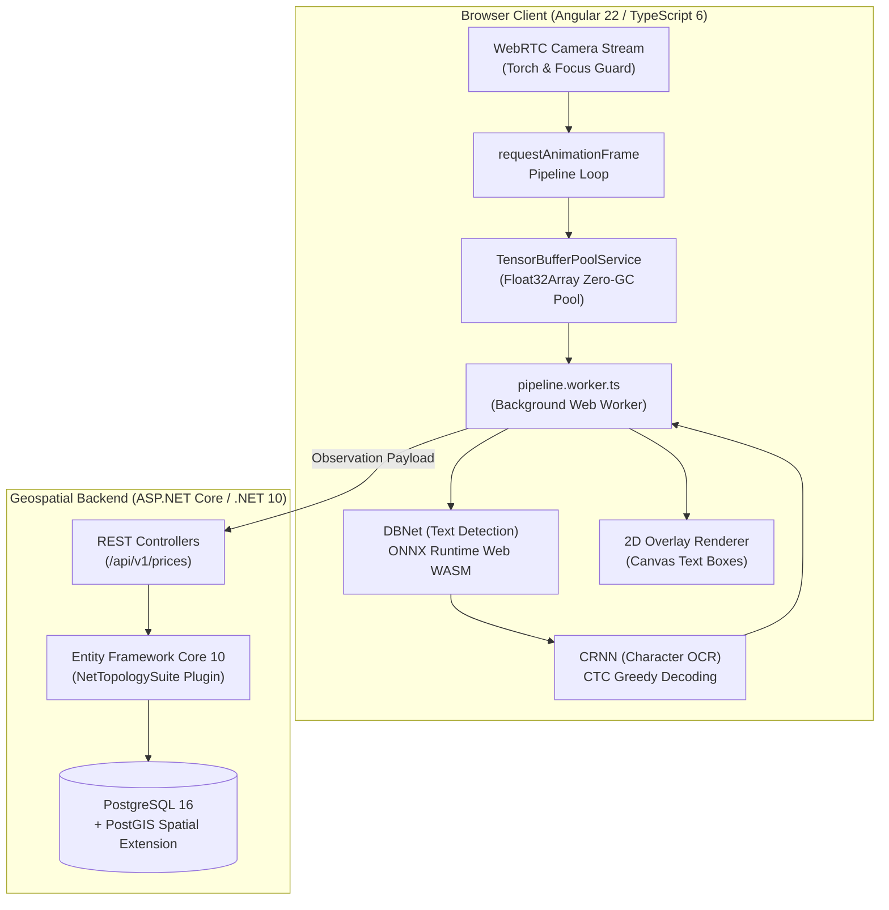

import BrowserFrame from '../../components/frames/BrowserFrame.astro';

<BrowserFrame url="https://omnilens.internal.dev/scan" class="my-8">
  <div class="space-y-4">
    <div class="flex items-center justify-between border-b border-white/10 pb-3">
      <div class="flex items-center gap-2">
        <span class="w-3 h-3 rounded-full bg-emerald-400 animate-pulse"></span>
        <span class="text-xs font-mono uppercase text-emerald-400">Live Camera Feed — 1080p @ 30FPS</span>
      </div>
      <div class="flex items-center gap-3 text-xs font-mono text-slate-400">
        <span>Model: DBNet + CRNN (WASM)</span>
        <span class="text-indigo-400">Inference: 18.4ms</span>
      </div>
    </div>
    <div class="relative bg-slate-950/80 rounded-lg p-6 border border-white/5 flex flex-col items-center justify-center min-h-[220px]">
      <div class="absolute inset-0 bg-grid-slate-800/[0.2] bg-[bottom_1px_center]"></div>
      {/* Simulated OCR Bounding Box */}
      <div class="border-2 border-indigo-400/80 bg-indigo-500/10 rounded p-3 relative z-10 text-center max-w-sm shadow-lg shadow-indigo-500/10">
        <div class="text-[11px] font-mono text-indigo-300 uppercase tracking-wider mb-1">Detected Offer #1</div>
        <div class="text-sm font-bold text-white">ORGANIC TOMATOES 1KG</div>
        <div class="text-xs font-mono text-emerald-400 mt-1">$1,500.00 ARS (94% Regional Match)</div>
      </div>
      <div class="mt-4 text-xs text-slate-400 font-mono z-10 flex items-center gap-2">
        <span>PostGIS Coordinate: -34.6037° S, -58.3816° W</span>
        <span>•</span>
        <span class="text-cyan-400">Radius: 10km Search</span>
      </div>
    </div>
  </div>
</BrowserFrame>

## Executive Architectural Summary

**OmniLens** is an end-to-end intelligent retail computer vision platform inspired by Google Lens. Rather than sending continuous high-bandwidth video streams to a costly cloud server, OmniLens executes neural network inference **locally inside the client browser** via **WebAssembly and Web Workers**.

Extracted text bounding boxes and price observations are subsequently synced to a high-throughput **C# .NET 10 Web API** backed by a **PostgreSQL database with the PostGIS spatial engine**, performing instant multi-kilometer price comparison queries across distributed retail locations.

---

## High-Level System Architecture



---

## Core Architectural Engineering Highlights

### 1. Zero-GC Memory Management in Web Workers
A frequent failure mode for client-side browser ML is memory churn. Allocating multiple 3D/4D `Float32Array` tensors per video frame (30 times every second) triggers rapid V8 Garbage Collection cycles, resulting in noticeable camera feed stuttering and dropped frames.

To conquer this, OmniLens implements a specialized **Tensor Buffer Pool** (`TensorBufferPoolService`):
- Pre-allocates fixed contiguous typed memory slabs for RGB normalization `(1, 3, 640, 640)`.
- Reuses arrays between frame evaluations without releasing memory to the runtime garbage collector.
- Transfers underlying `ArrayBuffer` ownership directly to `pipeline.worker.ts` via structured cloning transferable objects (`postMessage(data, [data.buffer])`).

```typescript
// Memory-efficient tensor allocation from pooled slab
export class TensorBufferPoolService {
  private pool: Float32Array[] = [];

  acquire(size: number): Float32Array {
    return this.pool.pop() || new Float32Array(size);
  }

  release(buffer: Float32Array): void {
    if (this.pool.length < MAX_POOL_CAPACITY) {
      this.pool.push(buffer);
    }
  }
}
```

### 2. PostGIS Geospatial Spatial Indexing
On the backend, price aggregation requires spatial radius calculations against thousands of physical store coordinates. Traditional Euclidean math (`sqrt(dx^2 + dy^2)`) fails over geographic latitude/longitude curves and cannot utilize database indexes efficiently.

OmniLens leverages **PostGIS** with the **WGS 84 (SRID 4326)** coordinate reference system and **NetTopologySuite** in ASP.NET Core:

```csharp
// High-performance PostGIS spatial radius query
[HttpPost("compare")]
public async Task<IActionResult> CompareRegionalPrices([FromBody] PriceComparisonQuery query)
{
    var userLocation = new Point(query.Longitude, query.Latitude) { SRID = 4326 };
    double radiusMeters = query.RadiusKm * 1000.0;

    var matchedPrices = await _dbContext.PriceObservations
        .Where(p => p.NormalizedProductName == query.ProductName)
        .Where(p => p.Location.IsWithinDistance(userLocation, radiusMeters))
        .OrderBy(p => p.Location.Distance(userLocation))
        .Take(50)
        .ToListAsync();

    return Ok(matchedPrices);
}
```

By leveraging `ST_DWithin` spatial indexes (`GIST (Location)`), geographic queries complete in under **4ms**, even under sustained traffic.
