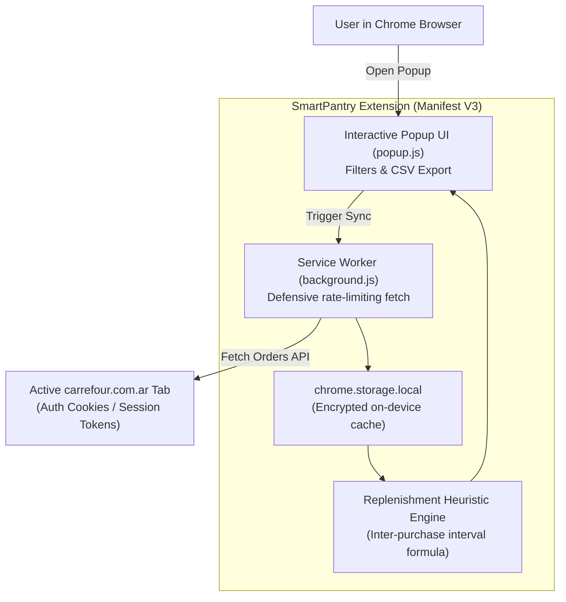

import ExtensionFrame from '../../components/frames/ExtensionFrame.astro';

<ExtensionFrame name="SmartPantry — Carrefour Reposición" class="my-8 max-w-md mx-auto">
  

    

      Sesión Carrefour Argentina:
      Activa (Cookie Auth)
    

    {/* Restock Recommendations List */}
    

      

        

          
Leche Entera Larga Vida 1L

          
Intervalo habitual: 7 días • Última compra: hace 12 días

        

        Atrasado (>130%)
      

      

        

          
Detergente Lavavajilla 500ml

          
Intervalo habitual: 28 días • Última compra: hace 25 días

        

        Te toca pronto
      

      

        

          
Café Tostado Molido 250g

          
Intervalo habitual: 21 días • Última compra: hace 5 días

        

        Al día (&lt;80%)
      

    

    

      <button class="px-3 py-1.5 rounded bg-indigo-600 hover:bg-indigo-500 text-white font-semibold text-[11px] transition-colors">
        Actualizar Historial
      </button>
      <button class="px-3 py-1.5 rounded bg-slate-800 hover:bg-slate-700 text-slate-300 font-semibold text-[11px] transition-colors">
        Exportar CSV
      </button>
    

  

</ExtensionFrame>

## Project Overview

**SmartPantry** is a Google Chrome extension (built natively on Manifest V3) designed to analyze household grocery purchase history from **Carrefour Argentina** (`carrefour.com.ar`) and predict when staple household items will run out based on past consumption cadence.

---

## Technical Architecture & Privacy Guarantees

---

## Engineering Highlights

1. **Zero External Storage Architecture:**  
   Unlike commercial price trackers that scrape and upload user receipt data to centralized marketing databases, SmartPantry executes 100% within the user's browser sandbox. Data never leaves `chrome.storage.local`.
2. **Incremental Session Synchronization:**  
   Fetches high-level order metadata and selectively queries detailed line items only for newly added, uncached orders. Defensive request spacing and exponential backoff prevent rate-limiting or session invalidation on the retailer's servers.
3. **Adaptive Replenishment Classification:**  
   Calculates median elapsed days between purchases for every product SKU:
   - **Atrasado, reponer:** Current interval exceeds **130%** of historical average.
   - **Te toca pronto:** Current interval falls between **80% and 130%**.
   - **Al día:** Current interval is below **80%**.
