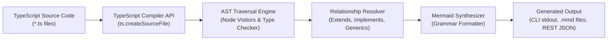

import TerminalFrame from '../../components/frames/TerminalFrame.astro';

<TerminalFrame command="npx ts2mermaid ./src/models --format class --direction TD" class="my-8">
  

    
🔍 Scanning TypeScript sources in ./src/models...

    
✓ Parsed 14 source files (48 interfaces, 12 classes, 8 type aliases)

    
⚙ Analyzing AST heritage clauses and member visibilities...

    
✨ Mermaid UML diagram successfully generated (dist/architecture.mmd):

    
    

      
classDiagram

      
class IAccountService &#123;

      
+authenticate(token: string): Promise&lt;User&gt;

      
#validateClaims(claims: TokenClaims): boolean

      
&#125;

      
IAccountService &lt;|.. AccountServiceImpl : implements

    

  

</TerminalFrame>

## Project Overview

**ts2mermaid** is a developer experience tool and microservice that inspects TypeScript source code, traverses its Abstract Syntax Tree (AST), and automatically compiles type relationships, interfaces, and class hierarchies into clean, copy-pasteable **Mermaid UML diagrams**.

---

## Technical Architecture & AST Pipeline

---

## Engineering Highlights

1. **Native TypeScript AST Traversal:**  
   Bypasses brittle regex parsing in favor of the official TypeScript Compiler API (`typescript`). Inspects syntax nodes down to token level, reliably capturing generic arguments, optional properties, method parameter types, and access modifiers (`public`, `protected`, `private`).
2. **Dual Operational Modes (CLI & Microservice):**  
   Can be run as a standalone terminal binary (`ts2mermaid`) within CI/CD pipelines to keep documentation diagrams continuously up to date, or hosted as an Express REST microservice providing diagramming capabilities to external web apps.
3. **Sequence & Class Diagram Synthesis:**  
   Supports generating both structural Class diagrams and interaction Sequence diagrams derived from async method invocation chains.
